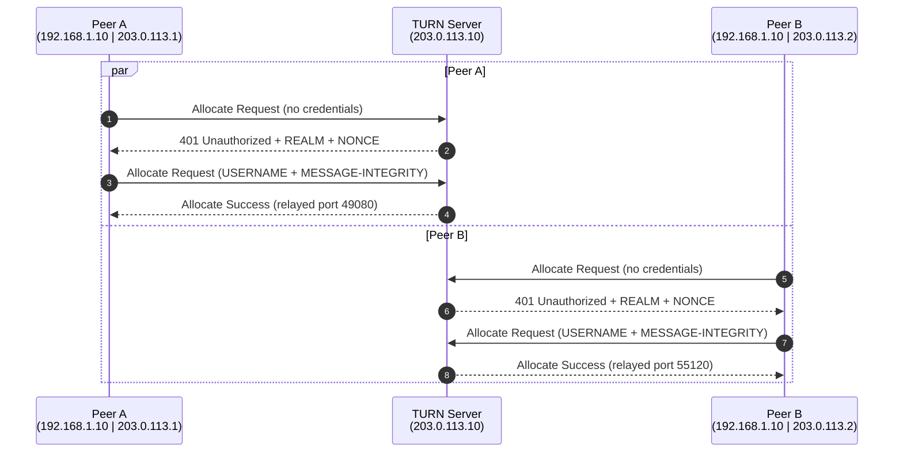
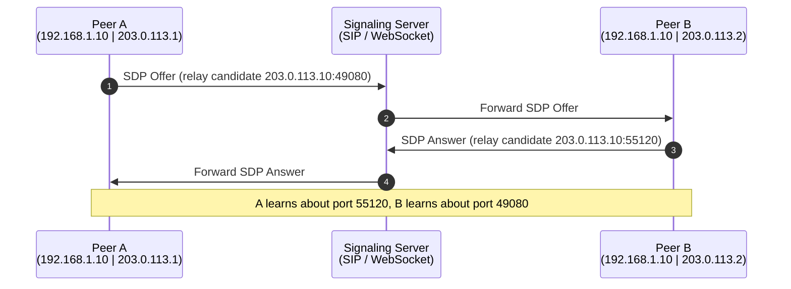
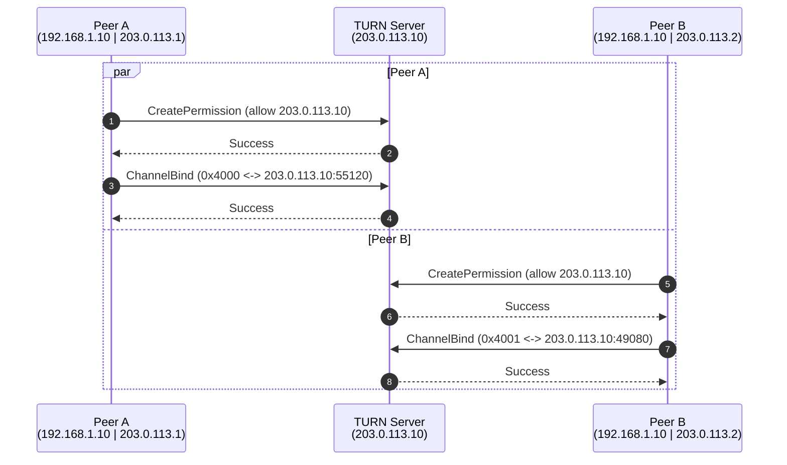
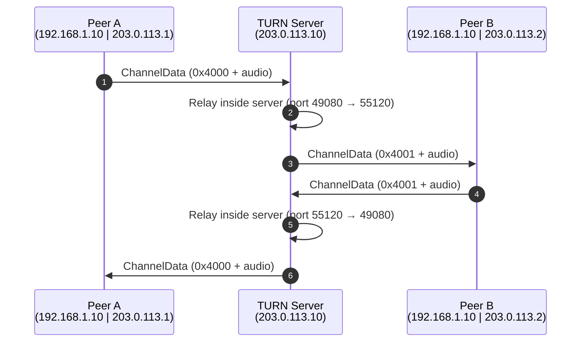
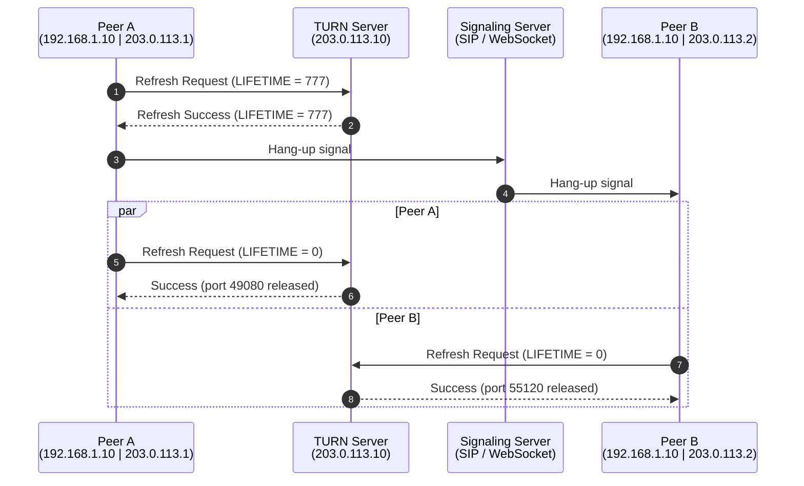

### Table of Contents

- [[#Overview|Overview]]
- [[#Private Network A:|Private Network A:]]
	- [[#Private Network A:#MicroTik 1|MicroTik 1]]
	- [[#Private Network A:#Host 1 (Linux)|Host 1 (Linux)]]
- [[#Private Network B:|Private Network B:]]
	- [[#Private Network B:#MicroTik 2|MicroTik 2]]
	- [[#Private Network B:#Host 2 (Linux)|Host 2 (Linux)]]
- [[#MicroTik 1 and MicroTik 2 connection|MicroTik 1 and MicroTik 2 connection]]
		- [[#Host 2 (Linux)#MicroTik 1|MicroTik 1]]
		- [[#Host 2 (Linux)#MicroTik 2|MicroTik 2]]
		- [[#Host 2 (Linux)#Connection between MicroTik 1 and MicroTik 2|Connection between MicroTik 1 and MicroTik 2]]
		- [[#Host 2 (Linux)#Check that NAT is working|Check that NAT is working]]
- [[#Public Host|Public Host]]
- [[#Download Coturn on PublicHost|Download Coturn on PublicHost]]
- [[#Set Up Coturn|Set Up Coturn]]
- [[#Set up a STUN server|Set up a STUN server]]
	- [[#Set up a STUN server#Test the STUN Server from Host1|Test the STUN Server from Host1]]
- [[#Installing Wireshark|Installing Wireshark]]
- [[#Analyze Packets Using Wireshark (STUN)|Analyze Packets Using Wireshark (STUN)]]
	- [[#Analyze Packets Using Wireshark (STUN)#Analyze STUN|Analyze STUN]]
		- [[#Analyze STUN#Binding Request|Binding Request]]
			- [[#Binding Request#Message Type|Message Type]]
			- [[#Binding Request#Message Length|Message Length]]
			- [[#Binding Request#Message Cookie|Message Cookie]]
			- [[#Binding Request#Transaction ID|Transaction ID]]
		- [[#Analyze STUN#Binding Success Response|Binding Success Response]]
			- [[#Binding Success Response#Attributes|Attributes]]
- [[#Set up a TURN server|Set up a TURN server]]
- [[#Analyze Packets Using Wireshark (TURN)|Analyze Packets Using Wireshark (TURN)]]
	- [[#Analyze Packets Using Wireshark (TURN)#Wireshark Packets|Wireshark Packets]]
			- [[#Binding Success Response#Allocate Request|Allocate Request]]
			- [[#Binding Success Response#Allocate Error Response|Allocate Error Response]]
			- [[#Binding Success Response#Allocate Request|Allocate Request]]
			- [[#Binding Success Response#Allocate Success Response|Allocate Success Response]]
			- [[#Binding Success Response#Refresh Request|Refresh Request]]
			- [[#Binding Success Response#Refresh Responce|Refresh Responce]]
			- [[#Binding Success Response#Channel-Bind Request|Channel-Bind Request]]
			- [[#Binding Success Response#Channel-Bind Success Responce|Channel-Bind Success Responce]]
			- [[#Binding Success Response#CreatePermission Request|CreatePermission Request]]
			- [[#Binding Success Response#CreatePermission Success Response|CreatePermission Success Response]]
			- [[#Binding Success Response#TURN ChannelData Message|TURN ChannelData Message]]
	- [[#Analyze Packets Using Wireshark (TURN)#Overview Diagrams|Overview Diagrams]]
		- [[#Overview Diagrams#Phase 1: Allocation on the TURN server|Phase 1: Allocation on the TURN server]]
		- [[#Overview Diagrams#Phase 2:  Address exchange via the signaling server|Phase 2:  Address exchange via the signaling server]]
		- [[#Overview Diagrams#Phase 3: Permissions and channel binding|Phase 3: Permissions and channel binding]]
		- [[#Overview Diagrams#Phase 4: Media exchange|Phase 4: Media exchange]]
		- [[#Overview Diagrams#Phase 5: Keep-alive and teardown|Phase 5: Keep-alive and teardown]]
- [[#NAT Filtering and Mapping in MicroTik|NAT Filtering and Mapping in MicroTik]]

### Overview
In the virtual environment, we will set up the following test stand:

### Private Network A:
#### MicroTik 1
MicroTik 1 is a router for the internal subnet, so it should have 2 interfaces:
1) the first one for the local network
2)  the second one for Internet access
To route traffic, we'll configure NAT

**MicroTik1**
Use following command to find out which interfaces **MikroTik1** has:
```python
interface/print
```


`ether1` -  our local network. In the MikroTik settings, this interface is assigned to the **host1** LAN segment.


`ether2` - public network. In the MikroTik settings, this interface belongs to the **network** LAN segment.


Add an address pool to the local network interface and specify the gateway `192.168.1.1`.
```python
ip/address/add address=192.168.1.1/24 interface=ether1
ip/address/print
```


#### Host 1 (Linux)
In the virtual machine settings, the **Network Adapter** is set to **LAN Segment**, and the `host1` segment is selected.


Open the network connection settings:


Let's move on to the connection settings:


Open the IPv4 settings:


Select **"Manual"** for the IPv4 method.
**Address:** `192.168.1.10`
**Subnet mask:** `255.255.255.0`
**Gateway:** `192.168.1.1`

Apply the changes:


After that, restart the `NetworkManager` service:


Verify that a connection to the **MikroTik1** exists using the `ping` command:


In my case, the ping goes through, so everything is set up correctly.

### Private Network B:

#### MicroTik 2
**MicroTik2** is a router for the internal subnet, so it should have two interfaces:
1) the first for the local network
2) the second for Internet access
To route traffic, we'll configure NAT

As with MicroTik 1, we have two interfaces:
`ether1` - local network (host2).
`ether2` - public network (network).
```python
interface/print
```


Add an address pool to the `ether1` interface:
```python
ip/address/add address=192.168.1.1/24 interface=ether1
ip/address/print
```


#### Host 2 (Linux)
Let's make sure that the interface is configured correctly in the settings for the **Host 2** virtual machine:


Since we configured a static IP address on **Host 1** using the graphical interface, we'll do the same on **Host 2** using the terminal:

Use the `ip -c a` command to list the interfaces:


We're interested in interface 1s **ens33**. It currently has no IP address.

Open the `00-installer-config.yaml` file:

```bash
sudo nano /etc/netplan/00-installer-config.yaml 
```

Since we're using a static IPv4 address, we'll disable `dhcp` for both IPv4 and IPv6.
We'll add the address `192.168.1.10` and specify the subnet mask as `/24`.
Add gateway information using `routes`. Add information specifying which daemon should handle network management - in our case, **NetworkManager**.

The file should end up with the following content:


```python
network:
  ethernets:
    ens33:
      dhcp4: false
      dhcp6: false
      match:
        macaddress: 00:0c:29:a4:ff:53
      set-name: ens33
      addresses:
        - 192.168.1.10/24
      routes:
        - to: default
          via: 192.168.1.1
  version: 2
```

**!!! It is important that `macaddress` matches the MAC address of the network interface (use the `ip -c a` command)*

Apply the changes using the following command:
```bash
sudo netplan apply
```


Let's check to see if the IP address has appeared:


We verify that the MikroTik and Linux systems are connected:

Linux:


MicroTik:


### MicroTik 1 and MicroTik 2 connection

##### MicroTik 1
Add IP addresses to the `ether2` interface:
```python
ip/address/add address=203.0.113.1/24 interface=ether2
ip/address/print
```


Now, configure NAT:
```python
/ip/firewall/nat/add action=masquerade chain=srcnat out-interface=ether2
```


- `/ip/firewall/nat/add`: Add a new NAT rule.
- `action=masquerade`: Replace the packet's source IP address with the IP address of the outgoing interface. Change the port as well, if necessary.
- `chain=srcnat`: Apply the rule to outgoing traffic, that is, change the sender's address.
- `out-interface=ether2`: Apply the rule only to packets that exit through the ether2 interface.

##### MicroTik 2

Add IP addresses to the `ether2` interface:
```python
ip/address/add address=203.0.113.2/24 interface=ether2
ip/address/print
```


Now, configure NAT:

```python
/ip/firewall/nat/add action=masquerade chain=srcnat out-interface=ether2
```


##### Connection between MicroTik 1 and MicroTik 2
Verify that **MicroTik1** and **MicroTik2** are connected using the `ping` command:

**MicroTik1** ping:


**MicroTik2** ping:


The ping is successful, which means there is a connection.
##### Check that NAT is working

Let's try pinging **MicroTik2** from **Host1**, and then **MicroTik1** from **Host2**.

**Host1:**


**Host2:**

****Ping** is successful, which means **NAT** is working.


### Public Host

In the virtual machine settings, under **Network Adapter**, set the **LAN segment** to `network`:


In the **Public Host** settings, set a static address:


Let's try pinging **Microtik1** and **Microtik2**:


Let's try pinging **PublicHost** from **Host1**:


Let's try pinging **PublicHost** from **Host2**:


Let's try pinging **Host1**/**Host2** from **PublicHost**:

*Network Unreachable.*

### Download Coturn on PublicHost
To download the file, we'll need a real Internet connection.
To do this, go to the virtual machine settings and add another network adapter:


Let's leave it in NAT mode:


Inside the virtual machine, we verify that we have Internet access by running a `ping` command:
```bash
ping 8.8.8.8
```


Now, install `coutun`:
```bash
sudo apt update
sudo apt install coturn
```


After successful installation, we can remove the network adapter:


### Set Up Coturn
Let's configure `turnserver` to start automatically as a system service when Ubuntu boots. To do this, edit the `/etc/default/coturn` file and uncomment the following line:


### Set up a STUN server

On **PublicHost**, open `/etc/turnserver.conf` and add the following settings:

```python
listening-ip=203.0.113.10
listening-port=3478
fingerpring
```

``listening-ip`: Specify the IP address from which we will accept requests.
`listening-port`: Specify the port on which requests will be received

Open the ports in the firewall:
```bash
sudo ufw allow 3478/udp
sudo ufw allow 3478/tcp
```


Restart `coturn` using the following command:
```bash
sudo systemctl restart coturn
```

#### Test the STUN Server from Host1
In the virtual machine settings, add a network adapter of the NAT type:


Install **coturn**:
```bash
sudo apt update
sudo apt install coturn
```


Removing a network adapter:


Send a request to an external server (STUN):
```bash
turnutils_stunclient -p 3478 203.0.113.10
```


We can see that the **STUN server** provided us with our public IP address and the port assigned by the NAT configured on **MicroTik1**.

### Installing Wireshark
Let's install Wireshark so we can reconstruct the chronology of connections and packet transmissions. The installation process for Wireshark is the same on all Ubuntu hosts.

```bash
sudo apt install wireshark
```

Select "Yes":


### Analyze Packets Using Wireshark (STUN)
#### Analyze STUN
Use the `ip -c a` command to find out the interface name. In my case, it's `ens33`:


Run **Wireshark** with administrator privileges:


Select the `ens33` interface:


Packet capture begins:


In the new terminal, we send a request to the STUN server:

```bash
turnutils_stunclient -p 3478 203.0.113.10
```


Go back to Wireshark and filter the packets by the server's IP and STUN:

```wireshark
ip.addr == 203.0.113.10
```


There is two packages. Let's take a closer look at them:

##### Binding Request
The client sends the first packet. It is called `Binding Request`.


A STUN packet is structured as follows:

Source: https://www.rfc-editor.org/info/rfc8489/#section-5

The first two bits, `00`, indicate that this is a STUN packet.

###### Message Type
The next 14 bits are the **STUN Message Type**. This is the message type. It is divided into a class (2 bits) and a method (12 bits).

Source: https://www.rfc-editor.org/info/rfc8489/#section-5

**Classes**
Two bits of the class field determine the direction and nature of the transaction (whether it is a request, a response, or simply a notification):
    - **0b00** (Request): The client sends a request to the server and expects a mandatory response.
	- **0b01** (Indication): A message is sent in one direction without expecting a response (for example, to maintain a NAT session: Keep-Alive).
	- **0b10** (Success Response): The server confirms that the request was processed successfully and returns data (for example, your public IP).
    - **0b11** (Error Response): The server reports that something went wrong.

**Methods**
In pure STUN, there is only one basic method:
    - **0x001** (Binding): A request to determine the external address.

If STUN is extended to the TURN protocol (RFC 8656, used for relaying traffic through a proxy server), new methods are added:
    - **0x003** (Allocate): A request to allocate a relay address on the server.
	- **0x004** (Refresh): Extends the lifetime of an allocated address.
    - **0x006** (Send): Sends data through the server.
    - **0x007** (Data): Receives data from the server.
	- **0x009** (CreatePermission): Request permission to exchange data with a specific peer.

**Message Method Assignment**
This bit indicates whether we are using officially documented methods or specific, third-party methods.
A value of 0 indicates that we are using the official standard, while 1 indicates the opposite.

In our case, the Message Class is **00**, which means we sent a `Request` class.
Our method is `0x001`, i.e., `Binding`.
Our Message Method Assignment is 0, which means we are using the official standard; therefore, Wireshark has determined that we have a `Binding Request`.

###### Message Length
**Message Length** specifies the length of **only the additional information (attributes)** that follows immediately after the main section of the 20-byte header.
In our case, the length is 0, since we do not have a section containing additional information.

###### Message Cookie
A fixed value of `0x2112A442` in network byte order. This helps distinguish `STUN` from other protocols.

###### Transaction ID
A 96-bit identifier that uniquely identifies a request/response pair. This helps match request and response pairs.
The user generates this randomly and sends the request to the server. When the server sends a response, it uses the exact same transaction ID. When the user receives a response from the server, they can establish an exact match between the request and the response.

##### Binding Success Response
In the response, we can see that:
**Message Type**:
- Class: `0x10` - Success Response
- Method: `0x001` - Binding (this is the only one for STUN)
**Message Length**: is 36 bytes because the Attributes field has been added.
**Message Transaction ID**: `136137a7cf6942644904ef50`, which is the same as the Message Transaction ID in the request. In other words, the server sent back the same Message Transaction ID that the user generated.


###### Attributes
An “Attributes” field has appeared in the response. Let's take a closer look at it:

Source: https://www.rfc-editor.org/info/rfc8489/#section-14

At the top level, each attribute has a fixed structure:
- **Attribute Type** (16 bits / 2 bytes): Type identifier.
- **Length** (16 bits / 2 bytes): Length of the *Value* field only, in bytes.
- **Value** (variable length): Payload.

The 16-bit Attribute Type field contains important rules for the program:
- **Bit 0** (Comprehension): Determines what to do if the type is unknown.
	- 0 means “Required” - a mandatory attribute that must be read. If it cannot be read, the packet is considered corrupted.
    - 1 means “Optional” - an optional attribute that can be ignored; therefore, if it cannot be read, it can simply be skipped.
- **Bit 1** (Assignment):
    - 0 means “IETF Review” (an official standard from an RFC).
    - 1 means “Vendor-specific” (a custom attribute from a specific manufacturer).
- **Bits 2–15** (14 bits): The sequence number of the attribute itself.

2. Analyzing an Actual Dump from Wireshark

In our case, the server sent a response with two attributes:
1) The XOR-MAPPED-ADDRESS attribute
2) The SOFTWARE attribute

**XOR-MAPPED-ADDRESS Attribute**:
The attribute type `0x0020` appeared in the dump. In binary, this is `0000 0000 0010 0000`.
- **The very first bit is 0**, which means that this attribute **must be read**.
- **The second bit is 0**, which means that the attribute is an official RFC standard.
- **Bits 2–15** store the numeric code `0x0020`. For the program, this is a clear signal: “The port and IP address are masked inside.”
- **Length**: Equals 8. This means that the payload in the Value field occupies exactly 8 bytes.
- **Value**: Contains information about the IPv4 protocol version (`0x01`), as well as the port and IP address, which are hidden using an XOR mask.
- **Port Decryption**: The packet contains the bytes `e00b`. To determine the actual port, the program performs an XOR operation with the most significant bytes of the Magic Cookie (`0x2112`). The result of XORing `0xe00b` with `0x2112` yields the actual port **49433**.
- **IP Decryption**: The packet contains the bytes `ea12d543`. The program performs an XOR operation with the entire Magic Cookie (`0x2112A442`). The result of `0xea12d543` XOR `0x2112A442` yields the net IP address **203.0.113.1**.

**SOFTWARE Attribute:**
The attribute type `0x8022` appeared in the dump. In binary, this is `1000 0000 0010 0010`.
- **The very first bit is 1**, which means that this attribute **is optional**. If our application were older and didn’t recognize this attribute, it would simply ignore it and continue running.
- **The second bit is 0**, which means that the attribute is **an official RFC standard**.
- **Bits 2–15 store** the numeric code `0x0022`. Based on this code, the program recognizes that the field contains the text name of the software.
- **Length 20**: This means that the payload in the `Value` field occupies exactly 20 bytes.
- **Value**: Contains the plain text "Coturn-4.6.1 'Gorst'". Since the text is exactly 20 bytes long and is divisible by 4 without a remainder, the server did not need to add empty bytes at the end for padding.

### Set up a TURN server

Just as you downloaded the **cuturn** client on **host1** in the [Set Up Coturn on Host1](#Set%20Up%20Coturn%20on%20Host1) section, download the client on **host2**.

On **PublicHost**, we change the turn server configuration:

```bash
sudo nano /etc/turnserver.conf 
```

```conf
listening-ip=203.0.113.10
listening-port=3478
fingerpring

# Add Relay port range 
min-port=49000
max-port=50000
lt-cred-mech
realm=testturnserver
```


We've added a couple of new fields:
**Min-port** and **Max-port** define the range of ports that will be assigned to users.

**lt-cred-mech** stands for **Long-Term Credential Mechanism**. Simply put: it involves verifying the client’s username and password when connecting to the TURN server.

**realm** is the authentication realm. Simply put, it’s the name of the realm to which the credentials belong.

Next, we update the firewall rules to allow traffic to the appropriate ports.

```bash
sudo ufw allow 49000:50000/udp
```


Now let's add some users.

```bash
sudo turnadmin -a -u host1 -p password123 -r testturnserver
sudo turnadmin -a -u host2 -p password123 -r testturnserver
```


Restart the `coturn` service:

``` bash
sudo systemctl restart coturn
```


We verify that the service has started without errors and is running:


To test whether the TURN server is working properly, we'll use the same utility, `turnutils_uclient`- this command simulates a call or chat and begins sending TURN packets continuously.

```bash
turnutils_uclient -y -u host1 -w password123 -p 3478 203.0.113.10
```

Let's break down what's happening here:
The `-y` flag indicates that you don't need to specify who to send packets to. The utility will automatically create a pair of clients and connect them via TURN. Traffic is guaranteed to go through the relay in both directions.

`-u host1 -w password123` specifies the user account created on the TURN server.

`-p 3478 203.0.113.10` specifies the port and address of the TURN server.


Everything is working.

### Analyze Packets Using Wireshark (TURN)

#### Wireshark Packets

Launch **Wireshark** on **Host1** and select the internal interface:


In the terminal, run the `turnutils_uclient` utility in **client-to-client** mode.


Filter packets based on the public server's IP address:

```wireshark
ip.addr == 203.0.113.10
```

###### Allocate Request


It is clear that the first request was an `Allocate Request`. Essentially, this is the STUN protocol, but using the `Request` class and the `Allocate` method.

`REQUESTED-TRANSPORT`: UDP Specifies the transport protocol that the TURN server should use for the allocated relay port (in this case, the UDP protocol is requested).

`LIFETIME 777`: Specifies the desired lifetime (in seconds) for the allocated connection and port on the server. If the client does not renew the request within 777 seconds, the server will release these resources.

`EVEN-PORT` Requires the server to allocate an even-numbered port for relaying. This is often required by the RTP protocol (for audio and video transmission), where the media stream itself travels over an even-numbered port, while the accompanying RTCP control protocol uses the next odd-numbered port.

`FINGERPRINT` Contains a checksum (CRC-32) of the entire packet. This attribute helps the recipient quickly distinguish STUN/TURN protocol messages from packets of other protocols (such as RTP or DTLS) that may be transmitted over the same network port.

###### Allocate Error Response


In response, a packet arrived with the message type `Allocate Error Response`, indicating that the server rejected the initial request.

In the attributes, you can see `ERROR-CODE 401 (Unauthenticated)`, which explains why the server rejected the initial request. This happened because the client was not authenticated by the server; in other words, the first request was sent without credentials.

`NONCE: ea0d5ec5b43599f0` A unique random string of characters generated by the server to protect against replay attacks. The client must include this value in its next request when calculating the password hash.

`REALM: testturnserver` The name of the authentication realm (security domain) on the server. It tells the client which specific username and password combination to use to access this server.

###### Allocate Request


The client sends another request to the TURN server to obtain a relayed address.
However, unlike the first request, this one includes the following attributes:
- `USERNAME`: the client’s account name, on behalf of which the request to obtain a relay port on the server is made.
- `NONCE`: a one-time cryptographic token that the server sent in the previous packet. By returning it, the client proves that the request is fresh and has not been intercepted by an attacker previously.
- `MESSAGE_INTEGRITY`: the cryptographic signature of the packet (HMAC-SHA1). It is calculated based on the contents of the entire message and a secret key derived from **USERNAME**, **REALM**, and **the user’s password**. This attribute allows the server to verify the client’s authenticity (without transmitting the password itself in plain text over the network) and ensure that the packet has not been altered during transmission.

###### Allocate Success Response


In the response, we can see that the server sent a successful response with a dedicated address.

`XOR-RELAYED-ADDRESS: 203.0.113.10:49080`: This is a public IP address and an even-numbered port on the TURN server, which have been specifically allocated for this client. The XOR prefix means that the address is masked so that intermediate NAT routers do not corrupt it during deep packet inspection.

`XOR-MAPPED-ADDRESS: 203.0.113.1:60737`: The client’s external public IP address and port, as seen by the TURN server after passing through the client’s NAT. This information allows the client to determine its public address on the Internet (as with a standard STUN request).

`RESERVATION-TOKEN`: A special reservation token that the server returns in response to the **EVEN-PORT** attribute in the request. The server has reserved the next odd-numbered port (`49081`), and the client can claim it with a separate request by presenting this token.

Next, the client will request another address from the new port and use the `RESERVATION-TOKEN` to obtain the reserved port:


###### Refresh Request


The client sends this request to extend the lifetime of a previously assigned relay address and port on the TURN server.

###### Refresh Responce


This is a response from the TURN server confirming that the lifetime timer for the allocated port has been successfully updated.

###### Channel-Bind Request


The client sends this request to associate a short 2-byte channel number with a specific IP address and port of the other party (peer). This allows data to be transmitted subsequently with minimal overhead (using compact _ChannelData_ messages instead of bulky _Send/Data_ headers). In addition, binding a channel automatically creates permission to receive traffic from that peer.

`CHANNEL-NUMBER: 0x5e39`: specifies the channel number that the client wants to assign to the peer. Going forward, all packets destined for this address will be marked with this short number.

`XOR-PEER-ADDRESS: 203.0.113.10:49081`: the IP address and port of the peer with whom data exchange is established via the TURN server. Like other addresses in STUN/TURN, it is masked using an XOR operation to protect against distortion by intermediate NAT routers.

###### Channel-Bind Success Responce 


This is the TURN server's response to a channel binding request, confirming that the channel number has been successfully bound to the peer's address.

###### CreatePermission Request


The client sends this request so that the TURN server will allow the reception and forwarding of incoming packets from a specific external address.

`XOR-PEER-ADDRESS: 203.0.113.10:49081`: specifies the IP address (and port) of the peer that is permitted to send data through a dedicated port on the TURN server.

###### CreatePermission Success Response


This is a confirmation from the TURN server that the filtering rule has been created and that the server will now accept and forward traffic from the specified peer to the client.

###### TURN ChannelData Message


This is the actual transmission of payload data to the counterpart via a previously established channel.

`Channel Number: 0x5147`: A two-byte channel identifier that the client has associated with a specific counterpart

`Data (100 bytes)`: the payload itself (for example, an RTP media packet containing audio or video), which the TURN server extracts from the ChannelData header and sends in its raw form via UDP to the other party’s address.

#### Overview Diagrams
##### Phase 1: Allocation on the TURN server

At this stage, both participants (Peer A and Peer B) independently contact the TURN server to lease a public IP address and a port for relaying traffic.

1. First, each client sends an **Allocate Request** without credentials, since it does not yet have a valid security token.
2. The server rejects the request with a **401 Unauthorized** error and returns the authentication realm (**REALM**) along with a one-time token (**NONCE**).
3. The clients resend the **Allocate Request**, adding a username (**USERNAME**) and a cryptographic signature (**MESSAGE-INTEGRITY**) calculated based on the password and the received token.
4. After successful verification, the server assigns each participant its own external relay port (**49080** for Peer A and **55120** for Peer B).



##### Phase 2:  Address exchange via the signaling server

The TURN server has no knowledge of who wants to connect to whom, so the participants exchange their dedicated relay addresses via a separate **signaling server**.

1. **Peer A** generates a session invitation (**SDP Offer**), specifying its leased address on the TURN server (`203.0.113.10:49080`), and sends it via the signaling server.
2. **Peer B** receives this offer, accepts the call, and sends its **SDP Answer** in response, specifying its own relay address (`203.0.113.10:55120`).
3. Once the exchange is complete, both peers know exactly which port on the TURN server to send packets to.




##### Phase 3: Permissions and channel binding

For security reasons, the TURN server blocks all incoming traffic on designated ports by default. Before starting a call, each participant must grant access to the other party and set up a fast transmission channel.

1. **CreatePermission:** Each participant informs the server of the other party’s IP address from which it is permitted to receive packets (in this case, both specify the relay server’s IP address `203.0.113.10`).
2. **ChannelBind:** To avoid sending long STUN headers containing the recipient’s full IP address and port in every packet, the participants associate a short 2-byte channel identifier with the other party’s address (**0x4000** for Peer A and **0x4001** for Peer B).




##### Phase 4: Media exchange

At this stage, a two-way real-time voice or video exchange begins using compact **ChannelData** messages (a header of just 4 bytes instead of a full STUN packet).

1. **Transmission from A to B:** Peer A encapsulates the audio packet in a **ChannelData** packet with channel number **0x4000** and sends it to the server. The TURN server forwards the data internally from port **49080** to port **55120**, repackages it into channel **0x4001**, and delivers it to Peer B.
2. **Transmission from B to A:** The reverse flow is the same in reverse—Peer B sends data to channel **0x4001**, the server transfers it from port **55120** to port **49080**, and sends it to Peer A with channel label **0x4000**.




##### Phase 5: Keep-alive and teardown

Port leases and channel bindings on the TURN server have a limited duration to prevent them from tying up server resources in the event of a connection failure.

1. **Keep-alive:** While a call is in progress, clients periodically send **Refresh Request** messages (specifying a **LIFETIME = 777** seconds) to reset the timer and extend the port lease.
2. **Call Termination (Teardown):** When one of the participants ends the call, a hang-up signal (**Hang-up signal**) is transmitted via the signaling server. After that, both clients send a final **Refresh Request with LIFETIME = 0**, causing the TURN server to immediately close the allocated ports (**49080** and **55120**) and clear the filtering rules.




### NAT Filtering and Mapping in MicroTik

According to **RFC 4787**, there are **3 types of mapping** and **3 types of filtering**, for a total of **9 combinations**.

**Mapping (how an external IP:port is selected for an internal IP:port):**
- **EIM (Endpoint-Independent)**: a single external IP:port for any recipient.
- **ADM (Address-Dependent)**: a new external port for each recipient’s IP.
- **APDM (Address-and-Port-Dependent)**: a new external port for each recipient’s IP:port pair.
**Filtering (who is allowed to send packets to this external IP:port):**
- **EIF (Endpoint-Independent)**: anyone.
- **ADF (Address-Dependent)**: only IP addresses to which the internal host has already sent packets.
- **APDF (Address-and-Port-Dependent)**: only IP:port combinations to which the host has already sent packets.

Add a second public address to **PublicHost**. To do this, first let's find out the interface name. In my case, it's `ens33`:


Add the static IP address `203.0.113.11/24`:

```bash
sudo ip address add 203.0.113.11/24 dev ens33
```


On the `coturn` server, add an additional IP address and an alternative port. To do this, open the configuration file `/etc/turnserver.conf` and add the following values:

```conf
listening-ip=203.0.113.11
alt-listening-port=3479

rfc5780
```


Next, delete or comment out the line `no-rfc5780`:


Save the configuration and restart the service:

```bash
sudo systemctl restart coturn
```


To determine what type of NAT we’re dealing with, you can run a test:
1) From the host, send a STUN request to the external server using the first IP address and the first port.
2) Receive the STUN response (Response 1).
3) In the same session, send a STUN request to the server’s second external IP address, but using the same port.
4) Receive a STUN response (response 2).
5) If **response 1** differs from **response 2**, continue as follows:
6) In the same session, send a STUN request to the external server’s second IP address and second port.
7) Receive a STUN response (response 3).
8) Compare the results.

If
- Answer 1 = Answer 2, then it is EIM
- Answer 1 != Answer 2, but Answer 2 = Answer 3, then it is ADM
- Answer 1 != Answer 2 and Answer 2 != Answer 3, then it is APDM

(Reference: https://www.rfc-editor.org/info/rfc5780/?utm_source=chatgpt.com#section-4.3)

To determine what type of filtering we’re dealing with, we can run a test:
1) From the host, send a STUN request to the first IP address of the external server.
2) Receive a STUN response from the primary IP address and port (response 1).
3) In the same session, send a STUN request to the first IP address, but ask the server to respond from a different IP address and port.
4) Check whether a response was received (response 2). If a response was received, then we have EIF (lets everyone through). If not, continue.
5) In the same session, send a STUN request to the first IP address, but ask the server to respond from the same IP address but on a different port.
6) Check whether a response was received (response 3).

If:
 - Response 3 was received, then it is ADF (allows access only from a known IP address; the port does not matter).
 - Neither response 2 nor response 3 was received, then it is APDF (allows access only from a known IP address and a known port).

(Reference: https://www.rfc-editor.org/info/rfc5780/?utm_source=chatgpt.com#section-4.4)

To determine the current **mapping** and **filtering**, you can use a utility from the `coturn` package called `turnutils_natdiscovery`.
We’ve already set up the necessary configuration for `coturn` above, so let’s move straight on to **Host1**.

On **Host1**, run `turnutils_natdiscovery -m -p 3478 203.0.113.10`. The `-m` flag indicates that we are running the utility to determine the **mapping** type:


Now, on **Host1**, run `turnutils_natdiscovery -f -p 3478 203.0.113.10`. The `-f` flag indicates that we are running the utility to detect the **filtering** type.


Based on the test results, it appears that our MikroTik is configured as follows:
- **Mapping**: EIM
- **Filtering**: APDF
