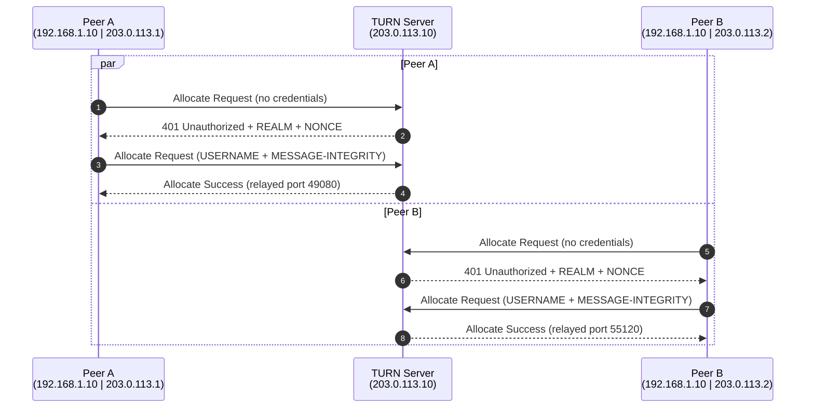
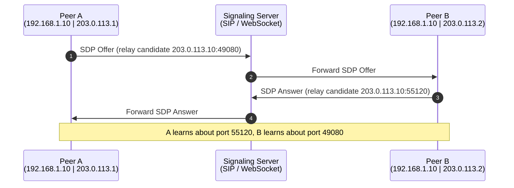
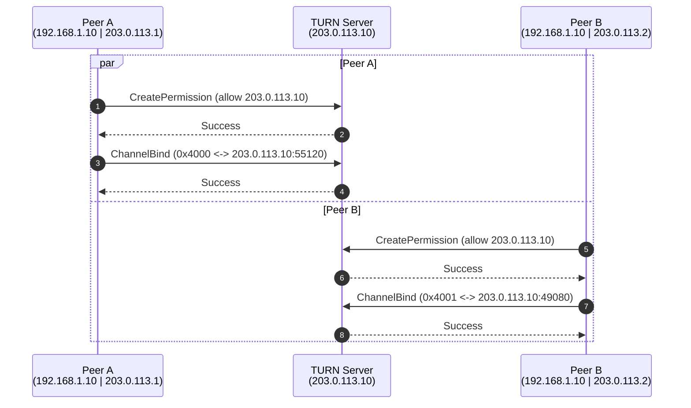
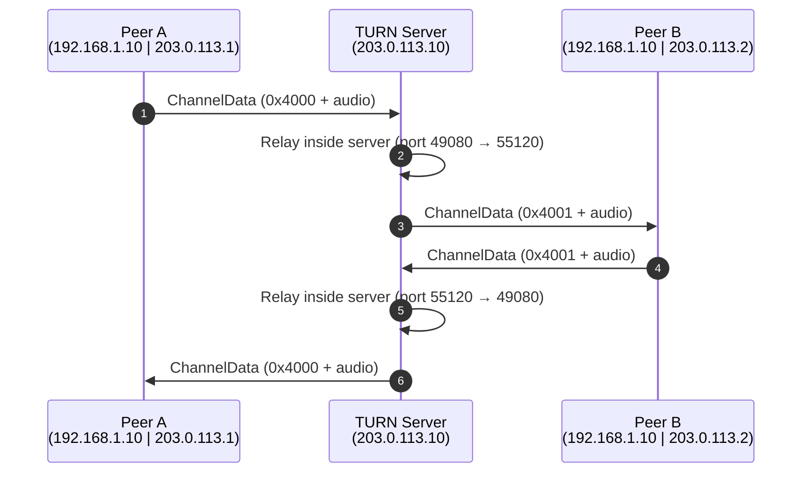
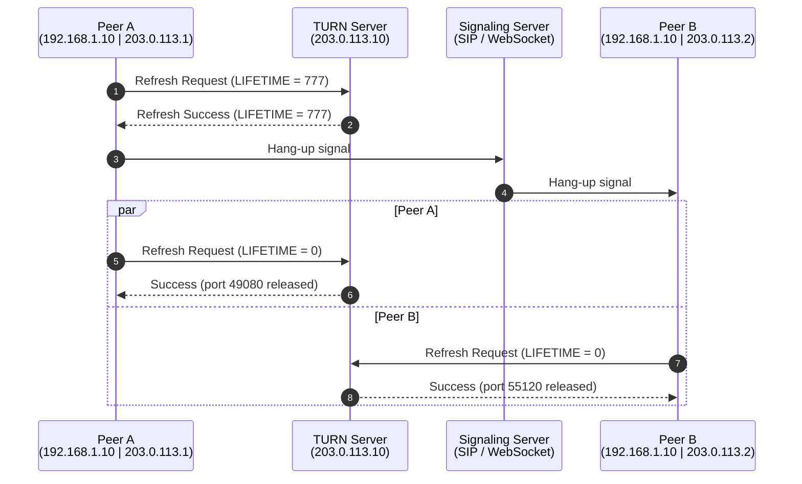

### Table of Contents

- [[#Overview|Overview]]
- [[#Настроим Private Network A:|Настроим Private Network A:]]
	- [[#Настроим Private Network A:#MicroTik 1|MicroTik 1]]
		- [[#MicroTik 1#MicroTik 1|MicroTik 1]]
	- [[#Настроим Private Network A:#Host 1 (Linux)|Host 1 (Linux)]]
- [[#Настроим Private Network B:|Настроим Private Network B:]]
	- [[#Настроим Private Network B:#MicroTik 2|MicroTik 2]]
	- [[#Настроим Private Network B:#Host 2 (Linux)|Host 2 (Linux)]]
	- [[#Настроим Private Network B:#Соединяем MicroTik 1 и MicroTik 2|Соединяем MicroTik 1 и MicroTik 2]]
		- [[#Соединяем MicroTik 1 и MicroTik 2#MicroTik 1|MicroTik 1]]
		- [[#Соединяем MicroTik 1 и MicroTik 2#MicroTik 2|MicroTik 2]]
		- [[#Соединяем MicroTik 1 и MicroTik 2#Проверяем соединение между MicroTik 1 и MicroTik 2|Проверяем соединение между MicroTik 1 и MicroTik 2]]
		- [[#Соединяем MicroTik 1 и MicroTik 2#Проверяем, что NAT работает|Проверяем, что NAT работает]]
- [[#Public Host|Public Host]]
- [[#Установим Coturn на PublicHost|Установим Coturn на PublicHost]]
- [[#Настроим Coturn|Настроим Coturn]]
- [[#Настроим STUN сервер|Настроим STUN сервер]]
	- [[#Настроим STUN сервер#Настроить Coturn на Host1|Настроить Coturn на Host1]]
- [[#Установка Wireshark|Установка Wireshark]]
- [[#Проанализируем пакеты с помощью Wireshark (STUN)|Проанализируем пакеты с помощью Wireshark (STUN)]]
	- [[#Проанализируем пакеты с помощью Wireshark (STUN)#Проанализируем STUN|Проанализируем STUN]]
		- [[#Проанализируем STUN#Binding Request|Binding Request]]
			- [[#Binding Request#Message Type|Message Type]]
			- [[#Binding Request#Message Length|Message Length]]
			- [[#Binding Request#Message Cookie|Message Cookie]]
			- [[#Binding Request#Transaction ID|Transaction ID]]
		- [[#Проанализируем STUN#Binding Success Response|Binding Success Response]]
			- [[#Binding Success Response#Attributes|Attributes]]
- [[#Настроим TURN сервер|Настроим TURN сервер]]
- [[#Проанализируем пакеты с помощью Wireshark (TURN)|Проанализируем пакеты с помощью Wireshark (TURN)]]
	- [[#Проанализируем пакеты с помощью Wireshark (TURN)#Wireshark Packets|Wireshark Packets]]
			- [[#Binding Success Response#Allocate Request|Allocate Request]]
			- [[#Binding Success Response#Allocate Error Response|Allocate Error Response]]
			- [[#Binding Success Response#Allocate Request|Allocate Request]]
			- [[#Binding Success Response#Allocate Success Response|Allocate Success Response]]
			- [[#Binding Success Response#Refresh Request|Refresh Request]]
			- [[#Binding Success Response#Refresh Responce|Refresh Responce]]
			- [[#Binding Success Response#Channel-Bind Request|Channel-Bind Request]]
			- [[#Binding Success Response#Channel-Bind Success Responce|Channel-Bind Success Responce]]
			- [[#Binding Success Response#CreatePermission Request|CreatePermission Request]]
			- [[#Binding Success Response#CreatePermission Success Response|CreatePermission Success Response]]
			- [[#Binding Success Response#TURN ChannelData Message|TURN ChannelData Message]]
	- [[#Проанализируем пакеты с помощью Wireshark (TURN)#Overview Diagrams|Overview Diagrams]]
		- [[#Overview Diagrams#Фаза 1: Allocation on the TURN server|Фаза 1: Allocation on the TURN server]]
		- [[#Overview Diagrams#Фаза 2:  Address exchange via the signaling server|Фаза 2:  Address exchange via the signaling server]]
		- [[#Overview Diagrams#Фаза 3: Permissions and channel binding|Фаза 3: Permissions and channel binding]]
		- [[#Overview Diagrams#Фаза 4: Media exchange|Фаза 4: Media exchange]]
		- [[#Overview Diagrams#Фаза 5: Keep-alive и teardown|Фаза 5: Keep-alive и teardown]]
- [[#NAT filtering и mapping|NAT filtering и mapping]]

### Overview
В виртуальной среде мы будем настраивать следующий стенд:


### Настроим Private Network A:

#### MicroTik 1
MicroTik 1 является роутером для внутренней подсети, так что у него должно быть 2 интерфейса:
1) первый для локальной сети
2) второй для выхода в интернет
Для маршрутизации трафика настроем NAT

##### MicroTik 1
С помощью команды узнаем какие интерфейсы есть у нас MicroTik:

```python
interface/print
```


`ether1` - наша локальная сеть. В настройках MicroTik данный интерфейс имеет локальный сегмент **host1**.


`ether2` - публичная сеть. В настройках MicroTik данный интерфейс имеет локальный сегмент **network**.


Добавляем на интерфейс для локальной сети пул адресов и указываем шлюз `192.168.1.1`. 

```python
ip/address/add address=192.168.1.1/24 interface=ether1
ip/address/print
```


#### Host 1 (Linux)
В настройках виртуальной машины **Network Adapter** установлен в **LAN Segment** и выбран сегмент `host1`


Открываем настройки подключения к сети:


Переходим к настройкам проводного подключения:


Открываем настройки IPv4:


В метод IPv4 указываем "вручную". 
**Адрес:** `192.168.1.10`
**Маска сети:** `255.255.255.0`
**Шлюз:** `192.168.1.1`

Применяем изменения:


После этого перезапускаем службу `NetworkManager`:


Проверяем, что соединение с MicroTik 1 существует с помощью команды `ping`:


В моем случае ping проходит, значит все настроено верно. 


### Настроим Private Network B:

#### MicroTik 2
MicroTik 2 является роутером для внутренней подсети, так что у него должно быть 2 интерфейса:
1) первый для локальной сети
2) интерфейс для выхода в интернет
Для маршрутизации трафика настроем NAT

Как и в случае с MicroTik 1, у нас имеется 2 интерфейса: 
`ether1` - локальная сеть (host2).  
`ether2` - публичная сеть (network). 

```python
interface/print
```


Добавляем пул адресов на интерфейс `ether1`:

```python
ip/address/add address=192.168.1.1/24 interface=ether1
ip/address/print
```


#### Host 2 (Linux)
Убеждаемся, что в настройках виртуальной машины **Host 2** правильно настроен интерфейс: 


Так как на **Host 1** мы настроили статический адрес с помощью графической оболочки, на **Host 2** сделаем это с помощью терминала:

С помощью команды `ip -c a` узнаем интерфейсы:

Нас интересует интерфей1с **ens33**. Сейчас на нем нет ip.

Открываем файл `00-installer-config.yaml`:
```bash
sudo nano /etc/netplan/00-installer-config.yaml 
```

Так как мы используем статический IPv4, то отключаем `dhcp` на IPv4 и IPv6.
Добавляем адрес `192.168.1.10` и указываем маску подсети с помощью `/24`.
Добавляем информацию о шлюзе с помощью `routes`. Добавляем информацию о том, какому демону передать управление сетью, в нашем случае **NetworkManager**.

В конце должен получиться следующее содержание файла


```python
network:
  ethernets:
    ens33:
      dhcp4: false
      dhcp6: false
      match:
        macaddress: 00:0c:29:a4:ff:53
      set-name: ens33
      addresses:
        - 192.168.1.10/24
      routes:
        - to: default
          via: 192.168.1.1
  version: 2
```
*!!! Важно, чтобы `macaddress` совпадал с macaddress сетевой карты (команда `ip -c a`)* 

Применяем изменения с помощью команды:
```bash
sudo netplan apply
```


Проверяем, что ip адрес появился: 


Проверяем, что microtik и linux имеют соединение:

Linux:


MicroTik:


#### Соединяем MicroTik 1 и MicroTik 2

##### MicroTik 1
Добавляем ip адреса на интерфейс `ether2`:

```python
ip/address/add address=203.0.113.1/24 interface=ether2
ip/address/print
```


Теперь настроим NAT:

```python
/ip/firewall/nat/add action=masquerade chain=srcnat out-interface=ether2
```


- `/ip/firewall/nat/add`: добавить новое правило NAT.
- `action=masquerade`: заменить исходный IP-адрес пакета на IP-адрес выходного интерфейса. Если необходимо, также изменить порт.
- `chain=srcnat`: применять правило к исходящему трафику, то есть менять адрес отправителя.
- `out-interface=ether2`: применять правило только к пакетам, которые выходят через интерфейс ether2.

##### MicroTik 2

Добавляем ip адреса на интерфейс `ether2`:

```python
ip/address/add address=203.0.113.2/24 interface=ether2
ip/address/print
```


Теперь настроим NAT:

```python
/ip/firewall/nat/add action=masquerade chain=srcnat out-interface=ether2
```


##### Проверяем соединение между MicroTik 1 и MicroTik 2
Проверяем, что **MicroTik1** и **MicroTik2** соединяются c помощью команды `ping`:

**MicroTik1** ping:


**MicroTik2** ping:


Ping проходит, а значит соединение есть. 

##### Проверяем, что NAT работает

Попробуем пропинговать MicroTik2 с Host1 и после MicroTik1 с Host2.

**Host1:**


**Host2:**

**Ping** проходит, значит **NAT** работает. 


### Public Host

В настройках виртуальной машины в **Network Adapter** ставим натсройки **LAN segment** как `network`:


В настройках **Public Host** ставим статический адрес:


Пробуем пропинговать **Microtik1** и **Microtik2**:


Попробуем с **Host1** пропинговать **PublicHost**:


Попробуем с **Host2** пропинговать **PublicHost**:


Попробуем с **PublicHost** пропинговать **Host1**/**Host2**:

*Network Unreachable.*

### Установим Coturn на PublicHost
Для скачивания нам понадобиться реальный выход в интернет.
Для этого заходим в настройки виртуальной машины и добавляем еще один сетевой адаптер:


Оставим его в режиме NAT:


Внутри виртуальной машины проверяем, что появился доступ в интернет c помощью пинга:

```bash
ping 8.8.8.8
```


Теперь устанавливаем `coutun`:

```bash
sudo apt update
sudo apt install coturn
```


После успешной установки, можно удалить сетевой адаптер:


### Настроим Coturn
Разрешим запускать `turnserver` автоматически как системную службу при загрузке Ubuntu. Для этого отредактируем файл `/etc/default/coturn` и расскоментируем следующую строку:


### Настроим STUN сервер

На **PublicHost** откроем `/etc/turnserver.conf` и добавим туда следующие настройки:

```python
listening-ip=203.0.113.10
listening-port=3478
fingerpring
```

`listening-ip`: указываем ip, с которого будем принимать запросы.
`listening-port`: указываем порт, на который будут приходить запросы

открываем порты в фаерволе:

```bash
sudo ufw allow 3478/udp
sudo ufw allow 3478/tcp
```


Перезапускаем `coturn` с помощью команды:
```bash
sudo systemctl restart coturn
```

#### Настроить Coturn на Host1

В настройках виртуальной машины добавляем сетевой адаптер с типом NAT:


Установим **coturn**:

```bash
sudo apt update
sudo apt install coturn
```


Удаляем сетевой адаптер:


Выполним запрос к внешнему серверу (STUN):

```bash
turnutils_stunclient -p 3478 203.0.113.10
```


Можно заметить, что **STUN сервер** выдал нам наш публичный ip и port, который присвоил NAT, который настроен на **MicroTik1**.

### Установка Wireshark
Установим Wireshark для того, чтобы восстановить хронологию соединения и отправки пакетов.  Процесс установки wireshark на все хосты ubuntu един. 

```bash
sudo apt install wireshark
```

Выбираем "Да":


### Проанализируем пакеты с помощью Wireshark (STUN)
#### Проанализируем STUN
С помощью команды `ip -c a` узнаем название интерфейса. В моем случае это `ens33`:


Запускаем **wireshark** с правами администратора:


Выбираем интерфейс `ens33`:


Начинается захват пакетов:


В новом терминале отправляем запрос к STUN серверу:

```bash
turnutils_stunclient -p 3478 203.0.113.10
```


Возвращаемся в Wireshark и фильтруем пакеты по ip stun сервера:

```wireshark
ip.addr == 203.0.113.10
```


Мы видим два пакета. Давайте проанализируем их ближе:

##### Binding Request 
Первый пакет отправляет клиент. Он называется `Binding Request`.


Пакет STUN состоит следующим образом:

Source: https://www.rfc-editor.org/info/rfc8489/#section-5

Первые два бита `00` говорят о том, что перед нами STUN пакет. 

###### Message Type
Следующие 14 бит - это **STUN Message Type**. Это тип сообщения. Он разделен на класс (2 бита) и метод (12 бит). 

Source: https://www.rfc-editor.org/info/rfc8489/#section-5

**Classes**
Два бита класса определяют направление и суть транзакции (запрос это, ответ или просто уведомление):
	-- **0b00** (Request): Клиент отправляет запрос серверу, ожидая обязательного ответа.
	-- **0b01** (Indication): Сообщение отправляется в одну сторону без ожидания ответа (например, для поддержания NAT-сессии: Keep-Alive).
	-- **0b10** (Success Response): Сервер подтверждает успешную обработку запроса и возвращает данные (например, ваш публичный IP).
	-- **0b11** (Error Response): Сервер сообщает, что что-то пошло не так.

**Methods**
В чистом STUN базовым является всего один метод:
	-- **0x001** (Binding): Запрос на определение внешнего адреса.

Если STUN расширяется до протокола TURN (RFC 8656, используется для ретрансляции трафика через прокси-сервер), добавляются новые методы:
	-- **0x003** (Allocate): Запрос на выделение реле-адреса на сервере.
	-- **0x004** (Refresh): Продление времени жизни выделенного адреса.
	-- **0x006** (Send): Отправка данных через сервер.
	-- **0x007** (Data): Получение данных от сервера.
	-- **0x009** (CreatePermission): Запрос прав на обмен данными с конкретным пиром.

**Message Method Assigment**
Это бит, который говорит о том, что мы используем официальные задокументированные метода или специфичные и сторонние. 
Бит 0 говорит, что мы используем официальный стандарт, а 1 наоборот. 

В нашем случае Message Class: **00**, а значит мы отправили `Request` класс.
Метод у нас `0x001`, то есть `Binding`.
Message Method Assigment у нас равен 0, а значит мы используем официальный стандарт, поэтому wireshark определил, что у нас `Binding Request`

###### Message Length
**Message Length** определяет длину **только дополнительной информации (атрибутов)**, которая идет сразу после основной секции 20-байтового заголовка.
В нашем случае длина равна 0, так как у нас нет секции с дополнительной информацией. 

###### Message Cookie
Фиксированное значение `0x2112A442` в сетевом порядке байтов. Это помогает отличать `STUN` от других протоколов.

###### Transaction ID
96-битный идентификатор, уникально определяющий запрос/ответ. Это помогает определять пары запросов и ответов.
Его генерирует пользователь случайным образом и отправляет запрос на сервер. Сервер, когда отправляет ответ, использует тот же самый transaction id. Когда пользователь получает ответ от сервера, он может сделать точное соответствие между запросом и ответом. 

##### Binding Success Response
В ответе мы можем заметить, что:
**Message Type**:
- Classs: `0x10` -  Success Response
- Method: `0x001` - Binding (он единственный для STUN)
**Message Length**: равен 36 байтам, потому что появилось поле Attributes.
**Message Transaction ID**: равен `136137a7cf6942644904ef50`, что равно Message Transaction ID запроса. То есть сервер отправил тот же Message Transaction ID, что сгенерировал пользователь. 


###### Attributes
В ответе появилось поле Attributes. Давайте рассмотрим его подробнее:

Source: https://www.rfc-editor.org/info/rfc8489/#section-14

На верхнем уровне каждый атрибут имеет фиксированную структуру:
	- **Attribute Type** (16 бит / 2 байта): Идентификатор типа.
	- **Length** (16 бит / 2 байта): Длина только поля Value в байтах.
	- **Value** (переменная длина): Полезная нагрузка.

Внутри 16-битного поля Attribute Type заложены важные правила для программы:
	- **Бит 0** (Comprehension): Определяет, что делать, если тип неизвестен. 
		- 0 означает "Required" -  обязательный атрибут к прочтению. Если его невозможно прочитать, пакет считается сломанным. 
		- 1 означает "Optional" - дополнительный атрибут можно проигнорировать, поэтому если его не получается прочитать, то его можно просто пропустить.
	- **Бит 1** (Assignment): 
		- 0 означает "IETF Review" (Официальный стандарт из RFC). 
		- 1 означает "Vendor-specific" (Кастомный атрибут от конкретного производителя).
	- **Биты 2-15** (14 бит): Порядковый номер самого атрибута.

2. Разбор реального дампа из Wireshark

В нашем случае сервер отправил ответ с двумя атрибутами: 
1) Атрибут XOR-MAPPED-ADDRESS
2) Атрибут SOFTWARE

**Атрибут XOR-MAPPED-ADDRESS**:
В дампе пришел тип атрибута `0x0020`. В двоичном виде это `0000 0000 0010 0000`.
- **Самый первый бит равен 0**, это значит, что данный атрибут **обязателен к прочтению**. 
- **Второй бит равен 0**, который означает, что атрибут является официальным из стандарта RFC.
- **Биты 2-15** хранят числовой код `0x0020`. Для программы это четкий сигнал: «Внутри лежат замаскированные порт и IP-адрес».  
- **Length** (Длина): Равна 8. Это значит, что полезные данные в поле Value занимают ровно 8 байт.  
- **Value** (Значение): Содержит информацию о версии протокола IPv4 (`0x01`), а также скрытые с помощью маски XOR порт и IP-адрес.  
- **Расшифровка порта**: В пакете передаются байты `e00b`. Чтобы узнать реальный порт, программа делает операцию XOR со старшими байтами Magic Cookie (`0x2112`). Результат `0xe00b` XOR `0x2112` дает реальный порт **49433**.  
- **Расшифровка IP**: В пакете передаются байты `ea12d543`. Программа делает операцию XOR со всем Magic Cookie (`0x2112A442`). Результат `0xea12d543` XOR `0x2112A442` дает чистый IP-адрес **203.0.113.1**.

**Атрибут SOFTWARE:**
В дампе пришел тип атрибута `0x8022`. В двоичном виде это` 1000 0000 0010 0010`.
- **Самый первый бит равен 1**, это значит, что данный атрибут **является необязательным**. Если бы наше приложение было старым и не знало этот атрибут, оно бы просто пропустило его и продолжило работу.
- **Второй бит равен 0**, который означает, что атрибут является **официальным из стандарта RFC**.
- **Биты 2-15 хранят** числовой код `0x0022`. По этому коду программа понимает, что внутри лежит текстовое название программного обеспечения.
- **Length 20**: Это означает, что полезные данные в поле Value занимают ровно 20 байт.
- **Value**: Содержит чистый текст "Coturn-4.6.1 'Gorst'". Так как длина текста составляет ровно 20 байт и без остатка делится на 4, серверу не пришлось добавлять в конец пустые байты для выравнивания.

### Настроим TURN сервер

Аналогично скачиванию клиента **cuturn** на **host1** в разделе [Настроить Coturn на Host1](#Настроить%20Coturn%20на%20Host1) скачиваем клиент на **host2**.

На **PublicHost** меняем конфигурацию turn сервера: 

```bash
sudo nano /etc/turnserver.conf 
```

```conf
listening-ip=203.0.113.10
listening-port=3478
fingerpring

# Add Relay port range 
min-port=49000
max-port=50000
lt-cred-mech
realm=testturnserver
```


Мы добавили пару новых полей: 
**Min-port** и **Max-port** определяют диапазон портов, которые будут выдаваться пользователям. 

**lt-cred-mech** расшифровывается как **Long-Term Credential Mechanism** - механизм долговременных учётных данных. Простыми словами: включает проверку логина и пароля клиента при подключении к TURN серверу.

**realm** - это область аутентификации (Authentication Realm). Простыми словами, название области, к которой относятся учётные данные.

После обновляем правила firewall, чтобы пропускать трафик на нужные порты.

```bash
sudo ufw allow 49000:50000/udp
```


Теперь добавим пользователей. 

```bash
sudo turnadmin -a -u host1 -p password123 -r testturnserver
sudo turnadmin -a -u host2 -p password123 -r testturnserver
```


Перезапускаем `coturn` службу:

``` bash
sudo systemctl restart coturn
```


Проверяем, что служба запущена без ошибок и работает:


Чтобы проверить работоспособность TURN сервер, воспользуемся той же утилитой `turnutils_uclient` - эта команда имитирует звонок/чат и начинает непрерывно слать TURN-пакеты.

```bash
turnutils_uclient -y -u host1 -w password123 -p 3478 203.0.113.10
```

Разберем, что здесь происходит:
Флаг `-y` говорит, что не нужно указывать, кому отправлять пакеты. Утилита сама создаст пару клиентов и свяжет их между собой через TURN. Трафик гарантированно пойдет через Relay в обе стороны.

`-u host1 -w password123` указываем пользователя, которого создали на turn сервере. 

`-p 3478 203.0.113.10` указываем порт и адрес TURN сервера. 


Можно заметить, что все работает. 

### Проанализируем пакеты с помощью Wireshark (TURN)

#### Wireshark Packets

Запускаем **wireshark** на **Host1** и выбираем внутренний интерфейс:


В терминале запускаем `turnutils_uclient` утилиту в формате **client-to-client**.


Отфильтруем пакеты по ip публичного сервера:

```wireshark
ip.addr == 203.0.113.10
```

###### Allocate Request


Видно, что первый запрос был `Allocate Request`. По сути это протокол STUN, но с классов `Request` и методом `Allocate`.

`REQUESTED-TRANSPORT`: UDP Указывает транспортный протокол, который TURN-сервер должен использовать для выделяемого ретрансляционного порта (в данном случае запрашивается протокол UDP).

`LIFETIME 777` Задает желаемое время жизни (в секундах) для выделенного соединения и порта на сервере. Если клиент не обновит запрос в течение 777 секунд, сервер освободит эти ресурсы.

`EVEN-PORT` Требует от сервера выделить четный номер порта для ретрансляции. Это часто нужно протоколу RTP (для передачи аудио и видео), где сам медиапоток идет по четному порту, а сопутствующий протокол управления RTCP использует следующий за ним нечетный порт.

`FINGERPRINT` Содержит контрольную сумму (CRC-32) всего пакета. Этот атрибут помогает получателю быстро отличить сообщения протокола STUN/TURN от пакетов других протоколов (например, RTP или DTLS), которые могут передаваться через тот же самый сетевой порт.

###### Allocate Error Response


В ответ пришел пакет с типом сообщения `Allocate Error Response`, которое говорит, что cервер отклонил первоначальный запрос. 

В атрибутах можно заметить `ERROR-CODE 401 (Unauthenticated)`, которая говорит, почему сервер отклонил первоначальный запрос. Это произошло из-за того, что сервер не авторизовался на сервере, то есть первый запрос был без учетных данных. 

`NONCE: ea0d5ec5b43599f0` Уникальная случайная строка символов, сгенерированная сервером для защиты от атак повторного воспроизведения. Клиент должен включить это значение в свой следующий запрос при вычислении хеша пароля.

`REALM: testturnserver` Имя области аутентификации (домена безопасности) на сервере. Оно подсказывает клиенту, какую именно пару логина и пароля нужно использовать для доступа к этому серверу.

###### Allocate Request


Клиент снова отправляет запрос на выделение ретранслируемого адреса на TURN сервере.
Но в отличии от первого запроса, появились такие атрибуты, как 
- `USERNAME`: имя учетной записи клиента, от лица которой запрашивается выделение ретрансляционного порта на сервере.
- `NONCE`: одноразовый криптографический токен, который сервер прислал в предыдущем пакете. Возвращая его обратно, клиент доказывает, что запрос свежий и не перехвачен злоумышленником ранее.
- `MESSAGE_INTEGRITY`: криптографическая подпись пакета (HMAC-SHA1). Она вычисляется на основе содержимого всего сообщения и секретного ключа, который формируется из **USERNAME**, **REALM** и **пароля пользователя**. Этот атрибут позволяет серверу проверить подлинность клиента (не передавая сам пароль по сети в открытом виде) и убедиться, что пакет не был изменен при передаче.

###### Allocate Success Response


В ответе мы можем заметить, что сервер прислал успешный ответ с выделенным адресом. 

`XOR-RELAYED-ADDRESS: 203.0.113.10:49080`: это публичный IP-адрес и четный порт на TURN-сервере, которые выделены специально для этого клиента. Префикс XOR означает, что адрес замаскирован, чтобы промежуточные NAT-маршрутизаторы не испортили его при глубокой проверке пакетов.

`XOR-MAPPED-ADDRESS: 203.0.113.1:60737`: Внешний публичный IP-адрес и порт самого клиента, какими их увидел TURN-сервер после прохождения клиентского NAT. Эта информация позволяет клиенту узнать свой публичный адрес в интернете (как при обычном STUN-запросе).

`RESERVATION-TOKEN` Специальный токен резервирования, который сервер возвращает в ответ на атрибут **EVEN-PORT** из запроса. Сервер зарезервировал следующий нечетный порт (`49081`), и клиент сможет забрать его отдельным запросом, предъявив этот токен.

Далее клиент запросит еще один адрес с нового порта и воспользуется `RESERVATION-TOKEN`, чтобы получить зарезервированный порт:


###### Refresh Request


Клиент отправляет этот запрос, чтобы продлить время жизни ранее выделенного ретрансляционного адреса и порта на TURN-сервере.

###### Refresh Responce


Это ответ TURN-сервера, который подтверждает, что таймер жизни выделенного порта успешно обновлен.

###### Channel-Bind Request


Клиент отправляет этот запрос, чтобы привязать короткий 2-байтовый номер канала к конкретному IP-адресу и порту собеседника (пира). Это позволяет в дальнейшем пересылать данные с минимальными накладными расходами (используя компактные сообщения _ChannelData_ вместо громоздких заголовков _Send/Data_). Кроме того, привязка канала автоматически создает разрешение на прием трафика от этого собеседника.

`CHANNEL-NUMBER: 0x5e39`: указывает номер канала, который клиент хочет закрепить за собеседником. В дальнейшем все пакеты для этого адреса будут маркироваться именно этим коротким номером.

`XOR-PEER-ADDRESS: 203.0.113.10:49081`: ip адрес и порт собеседника, с которым устанавливается обмен данными через TURN-сервер. Как и другие адреса в STUN/TURN, он замаскирован с помощью операции XOR для защиты от искажения промежуточными NAT-маршрутизаторами.

###### Channel-Bind Success Responce 


Это ответ TURN-сервера на запрос привязки канала (пакет № 36), который подтверждает, что номер канала успешно закреплен за адресом собеседникa.

###### CreatePermission Request


Этот запрос клиент отправляет для того, чтобы TURN-сервер разрешил прием и пересылку входящих пакетов от конкретного внешнего адреса.

`XOR-PEER-ADDRESS: 203.0.113.10:49081`: указывает IP-адрес (и порт) собеседника, которому разрешается отправлять данные через выделенный порт на TURN-сервере.

###### CreatePermission Success Response


Это подтверждение от TURN-сервера о том, что правило фильтрации создано и теперь сервер будет принимать и пересылать клиенту трафик от указанного собеседника.

###### TURN ChannelData Message


Это уже непосредственная передача полезных данных собеседнику через привязанный ранее канал.

`Channel Number: 0x5147` Двухбайтовый идентификатор канала, который клиент привязал к конкретному собеседнику

`Data (100 bytes)`: сама полезная нагрузка (например, медиапакет RTP с аудио или видео), которую TURN-сервер распакует из заголовка ChannelData и отправит в чистом виде по UDP на адрес собеседника.

#### Overview Diagrams
##### Фаза 1: Allocation on the TURN server

На этом этапе оба участника (Peer A и Peer B) независимо друг от друга обращаются к TURN-серверу, чтобы арендовать на нем публичный IP-адрес и порт для ретрансляции трафика. 

1. Сначала каждый клиент отправляет запрос **Allocate Request** без учетных данных, так как у него еще нет актуального токена безопасности.
2. Сервер отклоняет запрос с ошибкой **401 Unauthorized** и передает область аутентификации (**REALM**) вместе с одноразовым токеном (**NONCE**).
3. Клиенты повторно отправляют **Allocate Request**, добавив имя пользователя (**USERNAME**) и криптографическую подпись (**MESSAGE-INTEGRITY**), вычисленную на основе пароля и полученного токена.
4. После успешной проверки сервер выделяет каждому участнику свой внешний ретрансляционный порт (**49080** для Peer A и **55120** для Peer B).



##### Фаза 2:  Address exchange via the signaling server

TURN-сервер ничего не знает о том, кто с кем хочет связаться, поэтому участники обмениваются своими выделенными ретрансляционными адресами через отдельный **сигнальный сервер**.

1. **Peer A** формирует приглашение на сеанс (**SDP Offer**), указывая в нем свой арендованный адрес на TURN-сервере (`203.0.113.10:49080`), и отправляет его через сигнальный сервер.
2. **Peer B** получает это приглашение, принимает звонок и отправляет в ответ свой **SDP Answer**, в котором сообщает собственный ретрансляционный адрес (`203.0.113.10:55120`).
3. После завершения обмена оба собеседника знают, на какой именно порт TURN-сервера нужно отправлять пакеты.




##### Фаза 3: Permissions and channel binding

Ради безопасности по умолчанию TURN-сервер блокирует весь входящий трафик на выделенные порты. Перед началом разговора каждый участник должен открыть доступ для собеседника и настроить быстрый канал передачи.

1. **Создание разрешения (CreatePermission):** Каждый участник сообщает серверу IP-адрес собеседника, с которого разрешено принимать пакеты (в данном случае оба указывают IP-адрес ретранслятора `203.0.113.10`).
2. **Привязка канала (ChannelBind):** Чтобы не пересылать в каждом пакете длинные STUN-заголовки с полным IP-адресом и портом получателя, участники закрепляют за адресом собеседника короткий 2-байтовый идентификатор канала (**0x4000** у Peer A и **0x4001** у Peer B).




##### Фаза 4: Media exchange

На этом этапе начинается двусторонний обмен голосом или видео в реальном времени с использованием компактных сообщений **ChannelData** (всего 4 байта служебного заголовка вместо полноценного STUN-пакета).

1. **Передача от A к B:** Peer A упаковывает аудиопакет в **ChannelData** с номером канала **0x4000** и отправляет на сервер. TURN-сервер перенаправляет данные внутри себя с порта **49080** на порт **55120**, переупаковывает их в канал **0x4001** и доставляет Peer B.
2. **Передача от B к A:** Обратный поток идет зеркально - Peer B шлет данные в канал **0x4001**, сервер перекладывает их с порта **55120** на порт **49080** и отправляет Peer A с меткой канала **0x4000**.




##### Фаза 5: Keep-alive и teardown

Аренда портов и привязка каналов на TURN-сервере имеют ограниченный срок действия, чтобы не занимать ресурсы сервера при обрыве связи.

1. **Поддержание сессии (Keep-alive):** Пока идет разговор, клиенты периодически отправляют запросы **Refresh Request** (указывая время жизни **LIFETIME = 777** секунд), чтобы сбросить таймер и продлить аренду порта.
2. **Завершение вызова (Teardown):** Когда один из участников завершает звонок, по сигнальному серверу передается команда отбоя (**Hang-up signal**). После этого оба клиента отправляют финальный запрос **Refresh Request со значением LIFETIME = 0**, заставляя TURN-сервер немедленно закрыть выделенные порты (**49080** и **55120**) и очистить правила фильтрации.




### NAT filtering и mapping

Чтобы в будущем нам определить, какие настройки возможны у разных 

По **RFC 4787** есть **3 типа mapping** и **3 типа filtering**, всего **9 комбинаций**.

**Mapping (как выбирается внешний ip:port для внутреннего ip:port):**
- **EIM (Endpoint-Independent)**: один внешний ip:port для любого получателя.
- **ADM (Address-Dependent)**: новый внешний порт для каждого IP получателя.
- **APDM (Address-and-Port-Dependent)**: новый внешний порт для каждой пары IP:порт получателя.
**Filtering (кому разрешено слать пакеты на этот внешний ip:port):**
- **EIF (Endpoint-Independent)**: кому угодно.
- **ADF (Address-Dependent)**: только IP, которым внутренний хост уже отправлял пакеты.
- **APDF (Address-and-Port-Dependent)**: только ip:port, которым хост уже отправлял пакеты.

**Вопрос:** если Mapping отвечает только за то, как выделаются порты, а filtering за то, можно ли пропускать пакеты, то при слабом filtering возможно ли отправить пакет с другого ip и port при ADM или APDM? 

Добавим на **PublicHost** второй публичный адрес. Для этого сначала узнаем название интерфейса. В моем случае это `ens33`:


В настройках сети добавляем статический статический ip адрес `203.0.113.11`:

```bash
sudo ip address add 203.0.113.11/24 dev ens33
```


В `coturn` сервере добавляем дополнительный ip и альтернативный порт. Для этого открываем файл конфигурации `/etc/turnserver.conf` и добавляем следующие значения:

```conf
listening-ip=203.0.113.11
alt-listening-port=3479

rfc5780
```


После удаляем или комментируем строку `no-rfc5780`:


Сохраняем конфигурацию и перезапускаем службу:

```bash
sudo systemctl restart coturn
```


Чтобы понять, какой перед нами тип NAT, можно провести тест: 
1) C хоста отправляем stun запрос на внешний сервер на первый ip и первый порт. 
2) Получаем stun ответ (ответ 1).
3) В этой же сессии отправляем stun запрос на второй внешний ip сервера, но на тот же порт.
4) Получаем stun ответ (ответ 2).  
5) Если **ответ 1** отличается от **ответ 2**, то продолжаем:
6) В этой же сессии отправляем stun запрос на второй ip и второй порт внешнего сервера.
7) Получаем stun ответ (ответ 3).  
8) Сравниваем результаты.

Если 
- Ответ 1 = Ответ 2, это EIM
- Ответ 1 != Ответ 2, но Ответ 2 = Ответ 3, это ADM
- Ответ 1 != Ответ 2 и Ответ 2 != Ответ 3, это APDM

(Ссылка: https://www.rfc-editor.org/info/rfc5780/?utm_source=chatgpt.com#section-4.3)


Чтобы понять, какой перед нами тип Filtering, можно провести тест:
1) С хоста отправляем STUN запрос на первый IP внешнего сервера.
2) Получаем STUN-ответ с основного IP и порта (ответ 1).
3) В этой же сессии отправляем STUN-запрос на первый IP, но просим сервер ответить с другого IP и другого порта.
4) Смотрим, пришел ли ответ (ответ 2). Если пришел, значит у нас EIF (пропускает всех). Если нет, продолжаем. 
5) В этой же сессии отправляем STUN запрос на первый IP, но просим сервер ответить с того же IP, но с другого порта.
6) Смотрим, пришел ли ответ (ответ 3).

Если:
 - Пришел ответ 3, значит это ADF (пускает только со знакомого IP, порт не важен).
 - Не пришел ни ответ 2, ни ответ 3, значит это APDF (пускает только со знакомого IP и знакомого порта).

(Ссылка: https://www.rfc-editor.org/info/rfc5780/?utm_source=chatgpt.com#section-4.4)

Чтобы определить текущий **mapping** и **filtering** можно воспользоваться утилитой из пакета `coturn`, которая называется `turnutils_natdiscovery`. 
Выше мы настроили уже необходимую конфигурацию для `coturn`, поэтому сразу перейдем к **Host1**. 

На **Host1** запускаем `turnutils_natdiscovery -m -p 3478 203.0.113.10`. Флаг `-m` говорит о том, что мы запускаем утилиту для выявления типа **mapping**:


Теперь на **Host1** запускаем `turnutils_natdiscovery -f -p 3478 203.0.113.10`. Флаг `-f` говорит о том, что мы запускаем утилиту для выявления типа **filtering**.


После тестов видно, что нам MicroTik настроен следующим образом:
- **Mapping**: EIM
- **Filtering**: APDF
